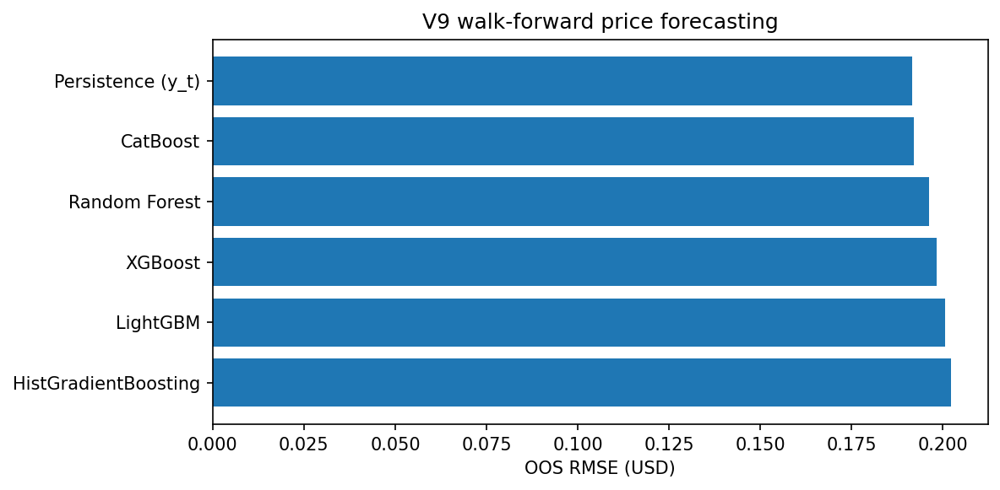
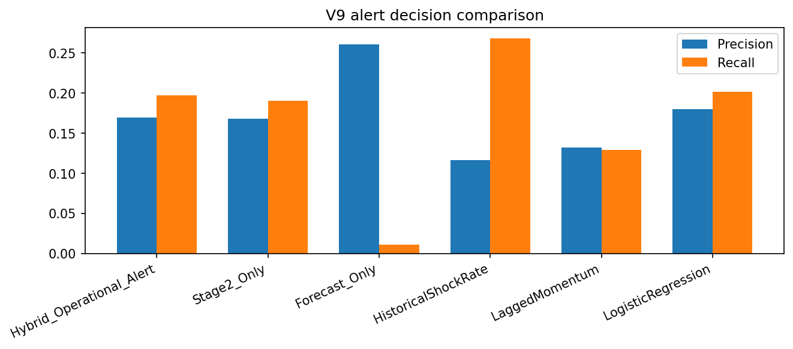
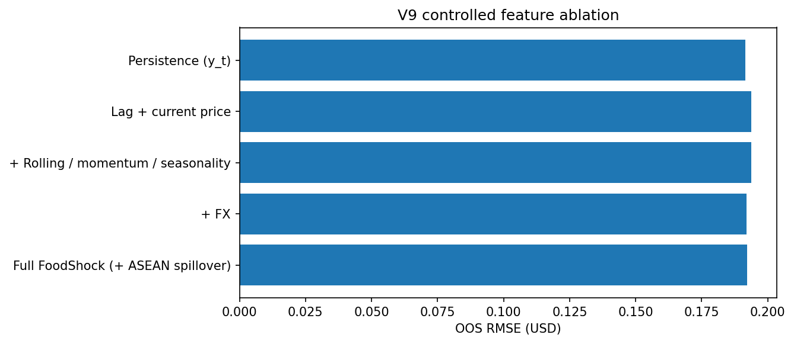
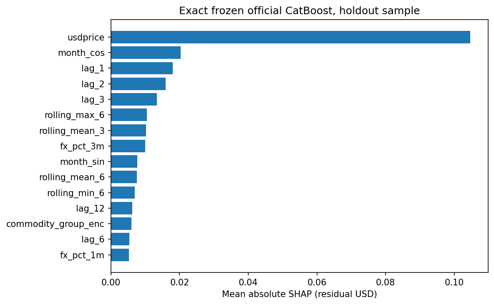

# V9 benchmark results (generated from saved outputs)

This report describes the actual run on the packaged model-ready panel. Dataset SHA-256: `ad9fefd80643b0b2d35f4301b02ff2b1c62f0ea4b0ee2789a6e31e8eeaf018c1`. Seed 42; 25 Optuna trials per tuned algorithm per fold. Seven non-overlapping walk-forward test windows cover 26,236 distinct market-month forecast origins. The separate official holdout is reported separately and is not added to the seven-fold sample.

## Regression benchmark

| model                |     n |   MAE_micro |   RMSE_micro |   sMAPE_micro |   R2_micro |   R2_delta |   MAE_macro |   SS_RMSE |   DM_pvalue | SS_RMSE_CI95       |
|:---------------------|------:|------------:|-------------:|--------------:|-----------:|-----------:|------------:|----------:|------------:|:-------------------|
| Persistence (y_t)    | 26236 |     0.09749 |      0.19157 |       2.9981  |    0.99381 |   -3e-05   |     0.0975  |   0       |   nan       | [0, 0]             |
| CatBoost             | 26236 |     0.10152 |      0.19213 |       3.18265 |    0.99377 |   -0.0059  |     0.10081 |  -0.00293 |     0.45693 | [-0.0235, 0.0129]  |
| Random Forest        | 26236 |     0.103   |      0.19617 |       3.20657 |    0.99351 |   -0.04859 |     0.10151 |  -0.02399 |     0.0315  | [-0.0591, 0.0030]  |
| XGBoost              | 26236 |     0.10695 |      0.19819 |       3.39436 |    0.99337 |   -0.07031 |     0.10699 |  -0.03454 |     0.79126 | [-0.0695, -0.0046] |
| LightGBM             | 26236 |     0.10952 |      0.20065 |       3.47513 |    0.99321 |   -0.09705 |     0.10694 |  -0.04738 |     0.01521 | [-0.0804, -0.0233] |
| HistGradientBoosting | 26236 |     0.11073 |      0.20224 |       3.4265  |    0.9931  |   -0.1145  |     0.10722 |  -0.05568 |     0.02143 | [-0.0874, -0.0262] |

CatBoost RMSE = **0.19213 USD** vs persistence **0.19157 USD**; pooled skill = **-0.29%**. A positive skill would mean improvement; the sign here is non-positive. The month-bootstrap skill CI is [-0.0235, 0.0129]; month-level HAC DM p=0.457. High price-level R² (0.9938) must not be interpreted as percentage accuracy: residual R² is -0.0059. The point model does not establish statistically reliable superiority to persistence on this evaluation. The DM loss uses equal-month averages rather than pooled row weights.

## Upward shock detection (hybrid alert vs ranking baselines)

| method                   |   Precision |   Recall |      F1 |     FPR |    PR_AUC |   ROC_AUC |   TP |   FP |   FN |    TN |    Lift |   Alerts_Per_Month |
|:-------------------------|------------:|---------:|--------:|--------:|----------:|----------:|-----:|-----:|-----:|------:|--------:|-------------------:|
| Hybrid_Operational_Alert |     0.16921 |  0.19689 | 0.182   | 0.09068 | nan       | nan       |  443 | 2175 | 1807 | 21811 | 1.9731  |           33.5641  |
| Stage2_Only              |     0.16771 |  0.19067 | 0.17845 | 0.08876 |   0.13197 |   0.60832 |  429 | 2129 | 1821 | 21857 | 1.95556 |           32.7949  |
| Forecast_Only            |     0.26087 |  0.01067 | 0.0205  | 0.00283 |   0.10273 |   0.51813 |   24 |   68 | 2226 | 23918 | 3.04186 |            1.17949 |
| HistoricalShockRate      |     0.11653 |  0.26844 | 0.16252 | 0.1909  |   0.10705 |   0.56282 |  604 | 4579 | 1646 | 19407 | 1.35885 |           66.4487  |
| LaggedMomentum           |     0.13215 |  0.12933 | 0.13073 | 0.07967 |   0.09833 |   0.49573 |  291 | 1911 | 1959 | 22075 | 1.54096 |           28.2308  |
| LogisticRegression       |     0.17962 |  0.20133 | 0.18986 | 0.08626 |   0.13453 |   0.60085 |  453 | 2069 | 1797 | 21917 | 2.09444 |           32.3333  |

Hybrid: precision **16.92%**, recall **19.69%**, FPR **9.07%**, base shock rate 8.58%, lift 1.97×, about 33.6 alerts per observed forecast month. True alerts: 443; false alerts: 2,175; missed shocks: 1,807. Month-bootstrap precision CI [0.1346, 0.2098], recall CI [0.1251, 0.2634]. Stage-2 ranking PR-AUC 0.132, ROC-AUC 0.608; these are score metrics, not hybrid binary AUC. Logistic regression achieves F1 0.1899 vs hybrid 0.1820, so a simpler baseline remains competitive. Use alerts only to prioritize investigation, not automate interventions.

Empirical interval coverage **78.00%** (target 80%); mean width 0.2649 USD. Time dependence means coverage is not guaranteed in future markets.

## Controlled feature ablation

| feature_set                        |   n_numeric_features |   MAE_micro |   RMSE_micro |   SS_RMSE |
|:-----------------------------------|---------------------:|------------:|-------------:|----------:|
| Persistence (y_t)                  |                    0 |     0.09749 |      0.19157 |   0       |
| Lag + current price                |                    6 |     0.10141 |      0.19381 |  -0.01171 |
| + Rolling / momentum / seasonality |                   18 |     0.10266 |      0.19377 |  -0.01146 |
| + FX                               |                   21 |     0.10148 |      0.19205 |  -0.00251 |
| Full FoodShock (+ ASEAN spillover) |                   23 |     0.10152 |      0.19213 |  -0.00293 |

All ML ablations include the three encoded category columns and share the full model's fold-specific tuned parameters. FX and regional features can be inspected independently; the table does not support claiming that every added feature improves pooled RMSE. Do not use these OOS results to select a new model and then report the same sample as an independent final test.

## Country coverage and errors (CatBoost)

| countryiso3   |     n |   MAE_micro |   RMSE_micro |   Persistence_RMSE |   SS_RMSE |
|:--------------|------:|------------:|-------------:|-------------------:|----------:|
| IDN           |  3780 |     0.06969 |      0.14311 |            0.14484 |   0.01195 |
| KHM           |  2722 |     0.08106 |      0.15474 |            0.1567  |   0.01245 |
| LAO           |  3642 |     0.11819 |      0.29484 |            0.29593 |   0.00368 |
| MMR           |    84 |     0.15421 |      0.7222  |            0.71719 |  -0.00698 |
| PHL           | 15793 |     0.1081  |      0.16818 |            0.16566 |  -0.01521 |
| THA           |    18 |     0.03039 |      0.04482 |            0.0446  |  -0.00507 |
| TLS           |   197 |     0.14407 |      0.30854 |            0.32738 |   0.05756 |

Philippines dominates the panel; sparse OOS markets have highly uncertain subgroup scores. Equal-country macro MAE is reported in the regression table.

## Official frozen holdout model (separate from aggregated OOS)

- Algorithm: CatBoost residual; fit through 2022-08-01; calibration 2022-10-01 to 2024-04-01; holdout begins 2024-06-01.
- Params: `{'n_estimators': 112, 'max_depth': 6, 'learning_rate': 0.03470870428658689}`; threshold = 0.700, qcal = 0.010303 USD.
- Fit/calibration/holdout counts: 10,834 / 9,268 / 6,957.
- RMSE 0.17401 vs persistence 0.17122; interval coverage 79.95%; hybrid precision 18.75%, recall 2.88%, FPR 0.79%. Very low holdout recall illustrates threshold drift and limits operational use.
- SHAP uses this exact fitted point model, with 1,200 held-out observations (or all when fewer than 1,200).

## Limitations and next work

The original raw snapshot from the declared Kaggle dataset, download date and license are not independently verified. Source series selection is retrospective and features assume timely publication. USD prices are not local household affordability measures. There is no causal or user-impact validation. The model is not a live forecasting service. A prospective later dataset, rolling calibration, validation-based persistence fallback, improved precision/recall and real stakeholder evaluation would be appropriate future work. No OOS results have been changed to imply those improvements already exist.
